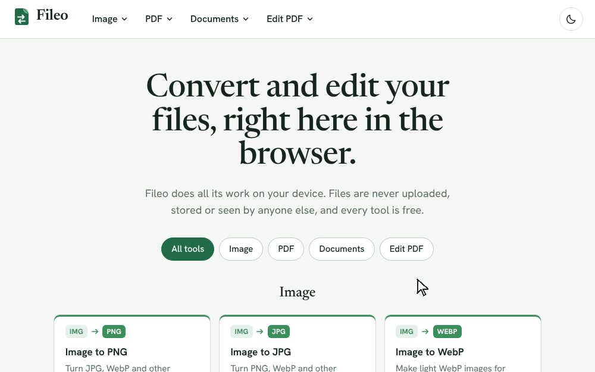
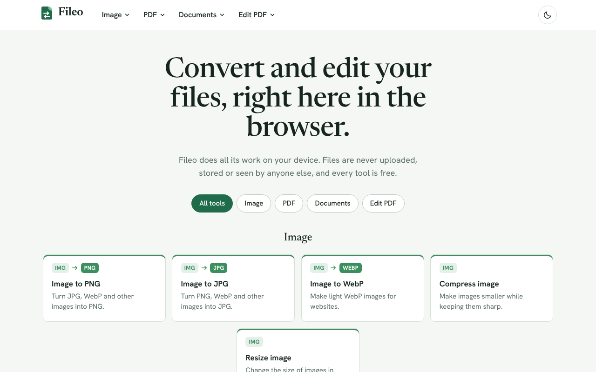
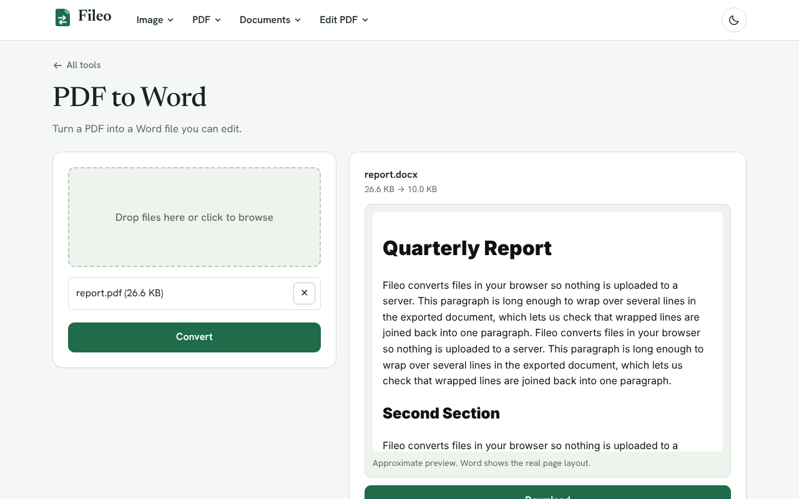
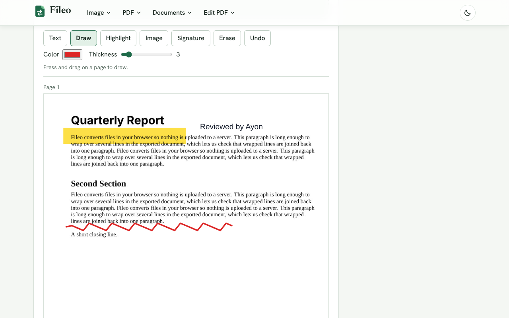
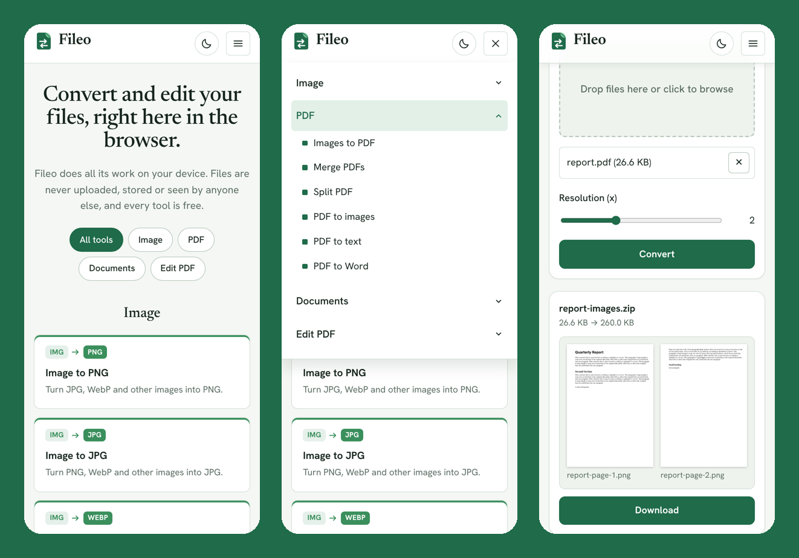
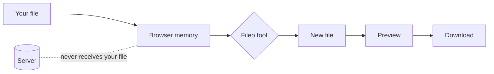

<div align="center">



<br />
<br />

**Free file converter and PDF editor that runs entirely in your browser.**
<br />
Your files never leave your device.

<br />


[Features](#features) · [Screenshots](#screenshots) · [Getting started](#getting-started) · [How it works](#how-it-works) · [Project structure](#project-structure)

</div>

<br />

<div align="center">
  
</div>

<br />

## Why Fileo

Most online converters upload your files to someone else's server. Fileo does the work inside your browser with JavaScript, so a contract, an ID scan or a class assignment stays on your own phone or computer. There is no account, no limit on how often you use it and nothing to install.

## Features

<table>
  <tr>
    <td width="50%" valign="top">

### 🖼️ Image

| Tool | From → To |
| --- | --- |
| Image to PNG | Any image → PNG |
| Image to JPG | Any image → JPG |
| Image to WebP | Any image → WebP |
| Compress image | Smaller file, same format |
| Resize image | New size in pixels |

</td>
    <td width="50%" valign="top">

### 📄 PDF

| Tool | From → To |
| --- | --- |
| Images to PDF | Images → one PDF |
| Merge PDFs | Many PDFs → one PDF |
| Split PDF | Page range → new PDF |
| PDF to images | PDF → PNG per page |
| PDF to text | PDF → TXT |
| PDF to Word | PDF → DOCX |

</td>
  </tr>
  <tr>
    <td width="50%" valign="top">

### 📝 Documents

| Tool | From → To |
| --- | --- |
| Word to HTML / PDF | DOCX → HTML or PDF |
| Markdown to HTML / PDF | MD → HTML or PDF |

</td>
    <td width="50%" valign="top">

### ✏️ Edit PDF

| Tool | What it does |
| --- | --- |
| Organize pages | Reorder, rotate, delete |
| Add text & draw | Text, pen, highlight, image, signature |

</td>
  </tr>
</table>

**Also built in**

- **Preview before download.** Every result opens next to the form: pages for PDFs, the picture for images, a readable view for Word, HTML and text, and thumbnails for ZIP files.
- **Batch conversion.** Drop up to 50 files at once, check each result, then download one file or all of them as a ZIP.
- **Light and dark theme.** Light by default, remembered on your device.
- **Works on phones.** The layout, menus and editors are made for touch screens too.

## Screenshots

<div align="center">

<picture>
  <source media="(prefers-color-scheme: dark)" srcset="docs/screenshots/home-dark.png" />
  
</picture>

<sub>Home page. It follows your GitHub theme: light or dark.</sub>

<br />
<br />

<picture>
  <source media="(prefers-color-scheme: dark)" srcset="docs/screenshots/convert-dark.png" />
  
</picture>

<sub>Files and options on the left, the preview and download on the right.</sub>

<br />
<br />



<sub>Mark up a PDF with text, a pen, highlights, images and your signature.</sub>

<br />
<br />



<sub>On a phone: home, the tools menu and a result with its preview.</sub>

</div>

## Getting started

You need [Node.js](https://nodejs.org/) 20.19 or newer (or 22.12 and newer), which is what Vite 8 asks for.

```bash
git clone https://github.com/estkayon/fileo.git
cd fileo
npm install
npm run dev
```

Then open the address Vite prints, usually `http://localhost:5173`.

To try it on your phone, run `npm run dev -- --host` and open the `Network` address on a phone that is on the same Wi-Fi.

### Scripts

| Command | What it does |
| --- | --- |
| `npm run dev` | Start the development server |
| `npm run build` | Type-check and build the site into `dist/` |
| `npm run preview` | Serve the built site locally |
| `npm run lint` | Check the code with ESLint |
| `npm run typecheck` | Check types with TypeScript |
| `npm run format` | Format all files with Prettier |

The build output in `dist/` is a plain static site, so any static host can serve it.

## How it works



1. The file you choose is read into the browser's memory. It is not sent anywhere.
2. The tool converts or edits it with JavaScript libraries that run on your device.
3. The new file is shown as a preview, and the download saves it straight from memory.

Heavy libraries such as the PDF engine load only when a tool needs them, so the first page opens fast.

| Job | Library |
| --- | --- |
| Create and edit PDFs | [pdf-lib](https://github.com/Hopding/pdf-lib) (MIT) |
| Read and render PDFs | [PDF.js](https://github.com/mozilla/pdf.js) (Apache-2.0) |
| Read Word files | [mammoth](https://github.com/mwilliamson/mammoth.js) (BSD-2-Clause) |
| Write Word files | [docx](https://github.com/dolanmiu/docx) (MIT) |
| Markdown | [marked](https://github.com/markedjs/marked) (MIT) |
| Clean HTML | [DOMPurify](https://github.com/cure53/DOMPurify) (MPL-2.0 or Apache-2.0) |
| Page to image for PDF export | [html2canvas-pro](https://github.com/yorickshan/html2canvas-pro) (MIT) |
| ZIP files | [fflate](https://github.com/101arrowz/fflate) (MIT) |
| Fonts | Newsreader and Hanken Grotesk via [Fontsource](https://fontsource.org/) (OFL-1.1), bundled with the site |

## Project structure

```text
src/
├── components/          UI: header, home page, tool pages, editors
│   └── preview/         One preview per result type
├── features/
│   ├── image/           Image converters
│   ├── pdf/             PDF converters and shared PDF helpers
│   │   ├── organize/    Organize pages
│   │   ├── annotate/    Add text & draw
│   │   └── toWord/      PDF to Word
│   ├── document/        Word and Markdown converters
│   ├── preview/         Logic behind the previews
│   ├── theme/           Light and dark theme
│   └── registry.ts      The list of converters
├── lib/                 Small helpers: file names, ZIP, download
├── types/               Shared types
├── tools.tsx            Tool names, descriptions and groups
└── index.css            Design tokens and all styles
```

### Adding a converter

1. Create a `Converter` in `src/features/...` with an `id`, `label`, `accept` and a `convert` function that returns `{ blob, fileName }`.
2. Add it to a group in `src/features/registry.ts`.
3. Add its card text and formats to `CONVERTER_DETAILS` in `src/tools.tsx`.

It then shows up on the home page, in the header menu and gets its own page, preview and batch support.

## Limits

Fileo is honest about what a browser can do on its own:

- **PDF to Word** keeps text, paragraphs and headings. Tables, images, columns and exact layout are not carried over yet.
- **Scanned PDFs** have no text to extract, so PDF to text and PDF to Word cannot read them (there is no OCR yet).
- **Text added to a PDF** supports English letters, numbers and common symbols for now.
- **Big files** depend on your device's memory. Organize pages and PDF to Word accept up to 200 pages, PDF to images up to 100, and Add text & draw up to 50. A batch can hold up to 50 files.

## Author

Made by **Md. Estiak Rahman Ayon**.

[](https://github.com/estkayon)
[](https://estkayon.github.io/Portfolio/)

## License

Released under the [MIT License](LICENSE). © 2026 Md. Estiak Rahman Ayon.
